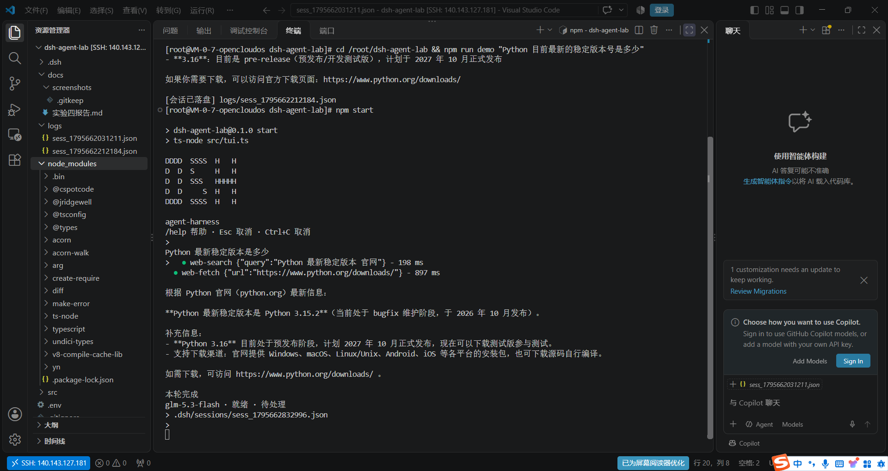

# 实验四报告：websearch tool 实现、preset 插件管理与 TUI 接入

| 项目 | 内容 |
|---|---|
| 课程 | 数据爬虫课程 |
| 姓名 / 学号 | 张宇枝 / 202408384246 |
| 项目 | dsh-agent-lab（命令行联网搜索 Agent） |
| 技术栈 | TypeScript 5.6 · Node.js 20 · ts-node · New API 中转（Anthropic Messages 协议）· glm-5.3-flash |
| 运行环境 | 腾讯云服务器 OpenCloudOS 9.6，Node v20.20.2 |

## 一、实验要求

实验四弹窗给出三条要求：

1. **构建 websearch tool**：可以使用 DeepSeek 的 API，或者免费的 DuckDuckGo、Tavily 等第三方 agent search 工具；
2. **理解 dsh 源码中 preset 插件管理的原理**，并落实到自己的项目当中；
3. **构建 TUI**，成功实现一个启动 websearch 工具的回复。

## 二、整体架构

项目沿用实验三最小 core 的分层结构，在其上补齐联网工具、预设插件装载与命令行界面：

```
┌─────────────────────────────────────────────┐
│  TUI（tui.ts）/ demo.ts  命令行交互与演示入口 │
├─────────────────────────────────────────────┤
│  Agent 装配层（agents.ts）                     │
├──────────────┬──────────────┬────────────────┤
│  LLM 接缝     │  Session      │  工具注册表      │
│ （llm.ts）    │ （session.ts）│ （registry.ts） │
├──────────────┴──────────────┴────────────────┤
│  preset 插件清单（preset.ts）                  │
│  execute_bash · web-search · web-fetch        │
└─────────────────────────────────────────────┘
```

闭环数据流：

```
用户提问
  → system + user 消息写入 Session
  → 模型推理（历史消息 + 工具定义一起送入）
  → 模型返回 tool_calls
  → 注册表按名分发到对应插件执行（计时）
  → 工具结果作为 tool 消息回填 Session
  → 再推理，直到模型不再调用工具
  → 输出最终答复，会话落盘 logs/*.json
```

## 三、关键实现

### 3.1 web-search 工具（`src/plugins/web-search.ts`）

- **搜索后端**：课程允许使用付费搜索 API 或免费第三方工具。实测 DuckDuckGo 的 html 与 api 端点在本地与服务器均无法连通，因此采用免费的 **Bing 中文搜索页**（`https://cn.bing.com/search`）解析结果，无需任何搜索 API 密钥。
- **解析流程**：请求结果页 HTML → 按 `b_algo` 结果块切分 → 正则提取标题、链接、摘要 → 去除脚本/样式/标签并解码 HTML 实体（含 `&#数字;`、`&#x十六进制;` 等数值实体）→ 按编号拼成文本列表返回。
- **参数 schema**：`query`（必填，搜索关键词）、`count`（可选，结果条数，1–10，默认 5）。

### 3.2 web-fetch 工具（`src/plugins/web-fetch.ts`）

模型在搜索结果中拿到具体链接后，用它读取页面正文：

- 校验 URL 协议（`http://` / `https://`）；
- 带浏览器 UA 请求页面，跟随重定向；
- 去掉脚本、样式、标签，解码常见实体，纯文本截断到 2000 字；
- 8 秒超时控制，超时或失败返回错误串，不抛异常炸掉闭环。

### 3.3 preset 插件管理原理（`src/plugins/`）

这是本实验第二条要求的落地部分。整套机制分三层：

**① 插件统一接口（`types.ts`）**

每个工具都是一个自包含对象，只暴露四样东西：

```ts
interface ToolPlugin {
  name: string;          // 工具名，模型按名调用，全局唯一
  description: string;   // 给模型看的说明，决定何时使用
  parameters: ToolParameters; // 参数 JSON Schema
  execute(args): Promise<string>; // 执行并返回字符串结果
}
```

**② 注册表（`registry.ts`）**

- `register(plugin)` / `registerAll(plugins)`：按名装入 Map；
- `toolDefinitions()`：把所有插件转成模型接口要的工具定义清单；
- `dispatch(call)`：按名查到插件执行，统一兜底异常；未知工具返回 `[error] 未知工具`，不崩溃。

注册表本身不认识任何具体工具，只认 `ToolPlugin` 接口。

**③ 预设清单（`preset.ts`）**

内置 preset 就是一组默认插件的打包清单：

```ts
export const builtinPreset: ToolPlugin[] = [bashPlugin, webSearchPlugin, webFetchPlugin];
export function createDefaultRegistry(): ToolRegistry {
  return new ToolRegistry().registerAll(builtinPreset);
}
```

Agent 启动时一次性把整组插件装载好。**新增工具的流程**：写一个新插件文件 → 加进 `builtinPreset` 数组；注册表、调度循环、TUI 都不需要改动。这就是 preset 插件管理的核心：**插件自包含、清单集中装载、注册表统一分发**。

与上游 dsh core 概念的对应关系：

| 上游 core 概念 | 本项目对应实现 |
|---|---|
| tools 包（工具注册表与执行流水线） | `plugins/registry.ts` |
| 原生工具执行插件 | `plugins/*.ts` 各插件的 `execute` |
| agent-loop（默认驱动器） | `agent-loop.ts` |
| session（会话事件日志） | `session.ts` |
| 模型接缝（llm seam） | `llm.ts` |

> 说明：上游完整仓库所在服务器本次未能取得登录权限，未能逐行阅读其源码；本项目按上述标准插件模式自行实现，分层与命名对照上游 core 的公开结构理解。

### 3.4 模型接缝与真实模型接入（`src/llm.ts`）

- `Llm` 接口只规定一个 `chat(messages, tools)` 方法，Agent 不依赖任何厂商 SDK；
- `AnthropicLlm`：走 Anthropic Messages 协议的 `/v1/messages` 端点，解析原生 `tool_use` 工具调用块；system 消息作为顶层参数发送，assistant 工具调用转成 `tool_use` 块，工具结果转成 `tool_result` 块回填；
- `DeepSeekLlm`：保留 OpenAI 兼容的 `/chat/completions` 实现，解析 `tool_calls`；
- `StubLlm`：离线脚本模型，没有密钥时也能跑通闭环，用于单元测试；
- `createLlm()`：按 `LLM_PROTOCOL` 环境变量选择协议（`anthropic` / `openai`），检测到 `LLM_API_KEY` 就用真实模型，否则退回 Stub。密钥通过项目根目录 `.env` 注入（已在 `.gitignore` 中，不提交 GitHub）。

本次接入课程发放额度的 New API 中转。接口 `/v1/models` 实际下发的模型为 `deepseek-v4-pro`、`deepseek-v4.1-flash`、`glm-5.3`、`glm-5.3-flash`；综合响应速度与工具调用稳定性，选用 **`glm-5.3-flash`**。

### 3.5 Agent 闭环与 TUI

- `agent-loop.ts`：每轮把完整历史 + 工具定义喂给模型；模型不再请求工具即收敛；`maxSteps = 8` 防止无限循环；工具执行记录耗时（`elapsedMs`）并通过事件回传界面。
- `tui.ts`：命令行交互入口，打印 DSH 横幅，逐条显示工具调用轨迹与耗时，输出模型答复后打印「本轮完成」与模型状态栏（`模型名 · 就绪 · 待处理`）和会话落盘路径；支持 `/help`、`/exit`。
- `demo.ts`：非交互演示入口，自动跑一条提问，便于冒烟测试和留档截图。

## 四、运行与测试结果

### 4.1 环境准备

```bash
npm install
```

### 4.2 定向测试（5 项全部通过）

```bash
npm test
```

```
定向测试开始：
  ✓ Session 追加消息后计数正确、history 只读返回
  ✓ 默认注册表已装载 web-search / web-fetch / execute_bash
  ✓ StubLlm 两轮后收敛：最后一轮不带 tool_calls
  ✓ 超过 maxSteps 应强制中止并抛错
  ✓ 未知工具返回错误串而不是崩溃

全部通过：5 项定向测试。
```

### 4.3 真实模型演示记录

提问：「Python 目前最新的稳定版本号是多少」

工具轨迹：

```
● web-search {"query":"Python 最新稳定版本 2025","count":5} - 235 ms
● web-fetch {"url":"https://www.python.org/downloads/"} - 911 ms
```

模型根据抓取到的官网下载页给出结论：Python 最新稳定版为 **3.15.2**，并补充了 3.15 维护周期、3.16 预发布状态与下载入口。会话完整记录落盘到 `logs/sess_*.json`。

### 4.4 启动 TUI

```bash
npm start
```

启动后在 `>` 提示符后输入问题回车即可；过程逐条打印 `web-search` / `web-fetch` 调用轨迹，最后输出答复。

## 五、遇到的问题与解决

| 问题 | 原因 | 解决方式 |
|---|---|---|
| DuckDuckGo 搜索不可用 | 本地与服务器访问 DDG 两个端点均超时（000） | 改用可达的 Bing 中文搜索页解析，免密钥 |
| 中转 OpenAI 端点工具调用不完整 | 部分上游模型在 `/chat/completions` 下不返回原生 `tool_calls`，工具调用被写进正文，或模型自称没有可用工具 | 改走 Anthropic `/v1/messages` 端点，解析原生 `tool_use` 块；`Llm` 接缝内保留两套协议实现，用环境变量切换 |
| 控制台展示域名公网解析不到 | 页面显示的域名未在公网 DNS 解析，本地与服务器均无法解析主机 | 经浏览器当前网关连接定位到实际接口地址，`.env` 直连该地址 |
| OpenAI 请求曾报 422：`missing field type` | 工具调用对象缺 `type: "function"`，且参数应序列化为字符串 | 映射时补上 `type`，`arguments` 用 `JSON.stringify` 序列化（OpenAI 实现内） |
| 摘要残留 `&#0183;` 等数值实体 | 原清洗只处理了命名实体 | 增加通用数值实体（十进制 / 十六进制）解码 |
| 个别页面抓取耗时过长 | 外部站点响应慢，fetch 无超时 | web-fetch 增加 8 秒 `AbortController` 超时，失败返回错误串 |
| 配置密钥后离线测试误调真实模型 | `createLlm()` 读到 `.env` 密钥即切换真实模型 | 定向测试显式注入 `StubLlm`，保证测试离线、可重复 |

## 六、不足与改进方向

1. 搜索后端为网页解析，结果相关性受搜索引擎页面结构影响；后续可接入 Tavily / Bing Web Search API 等结构化搜索接口。
2. web-fetch 目前只返回纯文本，不解析表格、图片等结构化内容；可针对新闻、文档页做正文抽取优化。
3. 工具调用目前串行执行；模型一次返回多个工具调用时可并行抓取以缩短耗时。
4. TUI 可补充工具结果预览、对话历史回看与快捷键操作。

## 七、目录结构

```
dsh-agent-lab/
├── src/
│   ├── llm.ts              # 模型接缝：AnthropicLlm + OpenAI 兼容实现 + StubLlm
│   ├── session.ts          # 会话消息记录与落盘
│   ├── agent-loop.ts       # 调度闭环
│   ├── agents.ts           # Agent 装配层
│   ├── tui.ts              # 命令行交互入口
│   ├── demo.ts             # 非交互演示入口
│   ├── error-test.ts       # 定向测试
│   ├── env.ts              # .env 加载器
│   ├── index.ts            # 统一导出
│   └── plugins/
│       ├── types.ts        # ToolPlugin 接口
│       ├── registry.ts      # 注册表
│       ├── preset.ts        # 内置 preset 清单
│       ├── bash.ts          # execute_bash
│       ├── web-search.ts    # web-search（Bing）
│       └── web-fetch.ts     # web-fetch
├── logs/                   # 会话落盘 JSON（不提交）
├── README.md
└── package.json
```

## 八、运行截图



提问「Python 最新稳定版本是多少」，TUI 自动调用 `web-search`、`web-fetch` 读取官网下载页后给出答复；轨迹、`本轮完成`、模型状态栏与会话路径均见上图。
